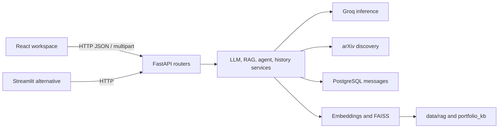

# ResearchMate: Technical Deep Dive

This document describes the implementation on `feature/react-frontend`. For installation commands and the project overview, see [README.md](README.md). Source behavior takes precedence over older comments and examples.

## 1. Architecture Overview

ResearchMate has two clients: a React research workspace and the preserved Streamlit application. Both call FastAPI over HTTP for conversation, document ingestion, retrieval-augmented generation (RAG), and agent routing. Python services handle Groq inference, embeddings, arXiv requests, and PostgreSQL persistence.

React produces static assets independently of Python. Its public `VITE_API_BASE_URL` selects the backend origin at build time; runtime features require a reachable API. Independent hosting requires CORS configuration and a static-host fallback to `index.html` for React Router. Streamlit remains runnable through `app.py`, with `views/` and `streamlit_frontend/api_client.py` using the same backend contracts.

## 2. Frontend Architecture

React, TypeScript, Vite, and Tailwind CSS provide the application shell. `App.tsx` wraps React Router with `SessionProvider`; `AppLayout` contains shared navigation and workspace layout. Routes are `/`, `/about-chatbot`, and `/about-developer`. Components are organized into shared `components/`, routed `pages/`, and chat, document, and settings `features/`.

**State and lifecycle.** Context holds session settings and the active attachment. Small external stores expose snapshots through `useSyncExternalStore`, avoiding a separate state-management dependency. A page-scoped closure creates one UUID using `crypto.randomUUID()`. Navigation retains it; a full reload generates another. Only normalized settings survive refresh through `sessionStorage`; conversation IDs, messages, and attachments do not. Database persistence therefore does not imply cross-refresh conversation restoration.

**Conversation flow.** `chatStore.ts` loads history, displays a local user message, sends one request, and reconciles with server history. Routing priority is Agent Mode, attached-document RAG, then Normal Chat. Each turn captures settings and attachment selection. Requests and reconciliation are serialized; unresolved synchronization blocks another send. Failed POSTs are not automatically retried because the server may already have persisted messages.

arXiv turns are retained locally because their backend handlers do not save history. For summaries, React preserves the user's visible wording even though the backend saves a fixed summary prompt. Abort controllers and generation counters prevent stale asynchronous results from updating the current view.

**HTTP boundary.** `services/api/` contains fetch helpers; `types/api.ts` defines wire contracts. The client validates the configured origin, restricts requests to that origin, omits credentials, and distinguishes configuration, HTTP, validation, network, response, timeout, and cancellation errors. Defaults are 30 seconds generally, 120 seconds for generation/uploads, and five seconds for health checks. TypeScript types are compile-time contracts; stores add selected response checks rather than comprehensive runtime schema validation.

PDF selection validates extension, MIME when supplied, and nonempty content. A successful upload supplies the active document ID; removal detaches locally without deleting server files. Processing status includes transfer and ingestion, without measured upload progress. Assistant messages use `react-markdown` and GFM, skip raw HTML, restrict link protocols, and replace images with alt text.

## 3. Backend & API Architecture

`backend/main.py` registers routers, CORS, and lifespan initialization. Startup constructs the Groq model registry and an in-memory portfolio retriever; portfolio initialization failure prevents startup. Interactive documentation and OpenAPI URLs are disabled. Health routes return static availability responses, without probing PostgreSQL or providers.

| Method and route | Responsibility |
| --- | --- |
| `GET /`, `GET /health` | API information and availability. |
| `POST /chat` | Persist a user turn, generate conversational output, save the answer. |
| `POST /documents/upload` | Accept multipart `file`, ingest PDF, return a document ID. |
| `POST /rag/query` | Retrieve document context and generate an answer. |
| `POST /agent/route` | Classify intent, dispatch one capability, return routing metadata. |
| `GET /history`, `DELETE /history` | Read or clear messages using the `session_id` query parameter. |
| `POST /portfolio/chat` | Answer developer-profile questions from `portfolio_kb/`. |

Pydantic schemas require nonempty session/message strings for main chat routes, constrain temperature to `[0, 1]`, and require positive token limits. The React token ceiling is 2,048; backend schemas impose no corresponding upper bound. RAG requires a document ID; agent requests accept one optionally. Portfolio requests use a separate schema and route-level whitespace checks.

API handlers orchestrate persistence and invoke `backend/core/` services through dependency helpers. Separation is incomplete: agent classification, capability dispatch, and arXiv integration reside in `backend/api/agent.py`. Portfolio chat similarly contains routing and prompt logic. These boundaries describe the current code, rather than a fully extracted service layer.

## 4. AI, RAG, and Evaluation

**Ingestion.** The upload route checks filename, PDF extension, content type when supplied, and nonempty bytes. Core ingestion assigns a UUID, writes the PDF under `data/rag/documents/`, and extracts text with `PyMuPDFLoader`. `RecursiveCharacterTextSplitter` uses **500 characters with 50-character overlap**, not token counts. `all-MiniLM-L6-v2` embeddings feed LangChain's FAISS wrapper. Index files and filename/chunk-count metadata persist under `indexes/` and `metadata/`.

**Answer generation.** Document queries load a persisted index or reuse a process-local retriever cache. The code uses default `as_retriever()` settings for uploaded documents, without an explicit K override. Retrieved chunks are combined with the system prompt and PostgreSQL conversation history through `create_stuff_documents_chain`. The current user message is already in that history. Responses contain text; `/rag/query` returns an empty `sources` array, so there is no extracted citation contract yet.

Portfolio retrieval separately embeds Markdown at startup, using the same embedding/chunk settings and an explicit **K=5**. Its route distinguishes greetings, follow-ups, and profile questions, sharing the history infrastructure without using uploaded-document indexes.

**LLM configuration.** Groq hosts `openai/gpt-oss-20b`; the current UI mapping is `GPT OSS`. Defaults are temperature `0.7` and `512` tokens, bound per request around registry clients. `AutoContinueLLM` detects provider length termination or missing terminal punctuation and can append up to two 512-token continuations. This can exceed the initial token setting and misclassify legitimate code/list endings. Although Groq clients enable streaming internally, HTTP routes return completed responses.

The UI offers five languages and passes `language` through requests, but current normal-chat/RAG prompts do not interpolate it. Selecting a language changes welcome text without reliably enforcing answer language. arXiv formatting is English.

**Evaluation.** `eval/run_eval.py` loads the local arXiv benchmark from `pdf/arxiv/`, builds a separate FAISS index, and retrieves ten chunks. Ground truth identifies relevant document sections. The loader implements its own recursive splitting with 500/50 character settings; evaluation embeddings are **`intfloat/e5-base-v2`**, differing from application embeddings.

| Metric | Definition | Saved value |
| --- | --- | --- |
| Recall@3 / @5 / @10 | Query hit rate: any relevant chunk within K. | 0.7846 / 0.8615 / 0.9692 |
| MRR | Mean reciprocal rank of the first relevant chunk. | 0.7236 |
| Average groundedness | Answer-token overlap with retrieved context. | 0.6519 |
| Grounded ratio | Fraction meeting the overlap threshold. | 1.0 |

[eval/results.json](eval/results.json) records these historical values at `2026-02-02T21:09:27.586513`, with 65 retrieval and 65 groundedness queries. It does not record the commit, model configuration, dataset fingerprint, or threshold; these are **saved results, not a fresh validation of current application quality**.

Current groundedness tokenizes ASCII alphanumeric words, removes stopwords, and uses a **0.20** overlap threshold. Empty tokenized answers score 1.0. This heuristic cannot establish factual correctness or semantic faithfulness and is unsuitable as multilingual quality evidence. Generation errors are recorded per query, so counts matter. The dataset is Git-ignored and must be supplied separately. `--skip-generation` runs retrieval only; `--include-details` records per-query output.

## 5. Agent Workflow

The implementation is a single dispatch pipeline, with no planning loop, tool recursion, or result-driven replanning:

1. Rule checks recognize greetings, very short input, and selected generic replies.
2. Otherwise, one classifier invocation searches the returned text for an allowed intent. It sees the message and document-presence flag, not conversation history.
3. The selected Python handler runs and assembles content, intent, confidence, and metadata.

| Capability | Implementation |
| --- | --- |
| Chat / fallback | Use normal chat with persisted history. Unrecognized classifier output selects fallback; missing-document RAG classifications redirect to chat. |
| Document Q&A | Load the selected retriever and run the shared RAG chain. |
| Summary | Replace the request with a fixed summary instruction, save it, and query the same retriever. Coverage is limited to retrieved chunks. |
| arXiv search | Remove common request phrases; request up to five results sorted by submission date. |
| Recommendations | Extract a topic and search arXiv by relevance, without personalized ranking. |

Confidence values are assigned constants, not calibrated probabilities. arXiv results contain bibliographic information and abstract excerpts; handlers do not download and analyze paper bodies. Search exceptions become empty results, conflating failures with no matches. Neither arXiv handler persists turns. The routing path has one classifier invocation, but its continuation wrapper means total provider calls are not strictly capped at two.

## 6. Database & Session Management

PostgreSQL stores `chat_messages`: generated ID, session ID, constrained role, content, and timestamp. SQLAlchemy Core constructs parameterized operations; messages are retrieved by session and ordered by creation time. User and assistant inserts commit separately, so generation failure can leave a user-only turn.

Session IDs are caller-supplied grouping keys, without authentication or ownership checks. Uploaded document IDs are also not associated with an authorized user. A significant concurrency limitation is the process-global history-store singleton's mutable `_current_session_id`: interleaved requests can overwrite session context. Frontend serialization protects one workspace, not concurrent clients; request-scoped context or explicit session arguments are needed.

`backend/init_db.py` references configuration attributes that no longer exist; use the schema-based setup in README. SQLAlchemy is explicitly declared in `requirements-test.txt`, despite runtime use.

## 7. Deployment & CI/CD

The checked-in deployment targets an AWS EC2 host through SSH and restarts `researchmate_backend` and `researchmate_frontend` systemd services. HTTPS smoke checks target `api.researchmate.me/health` and `researchmate.me`. Existing documentation identifies Streamlit as the deployed interface; the live version is unconfirmed.

Nginx appears in the old document as an example/recommendation. No checked-in Nginx configuration, certificate automation, systemd units, or infrastructure definitions verify the actual reverse proxy, HTTPS termination, or database hosting. RDS, S3, and container orchestration are therefore not asserted as deployed components.

GitHub Actions runs Ruff, then pytest on Python 3.11 for `main` pushes and manual dispatch. Deployment additionally requires manual dispatch or `Deploy it` in the head commit message. It resets the host to `origin/main` and restarts services, without dependency installation or database migration. Gitleaks scans main-targeting pushes/pull requests.

React has no CI build/deploy step yet. Its hosting, route fallback, and production API configuration remain separate work. No tracked tests exist in this checkout, so pytest currently collects none; React provides lint/build scripts without a test script.

## 8. Engineering Decisions & Limitations

- **HTTP separation** keeps secrets and AI/storage dependencies server-side while allowing independent clients and deployments. Contract synchronization and network-failure handling remain necessary.
- **FAISS persistence** keeps per-document retrieval simple, but local files and process caches need lifecycle management and shared storage before horizontal scaling.
- **Single-pass routing** bounds workflow complexity, but cannot refine a search or recover through alternate tools.
- **Security gaps:** CORS is wildcard-configured; routes lack authentication, ownership enforcement, and explicit upload-size limits. FAISS loading enables pickle deserialization and must use trusted server-managed files. Several HTTP errors expose raw exception text.
- **Next improvements:** fix session concurrency and language prompting, align evaluation with application retrieval, record reproducible benchmark configuration, restore tests, and add citations, bounded history, full-document summarization, and retention controls. These are proposals, not implemented features.
