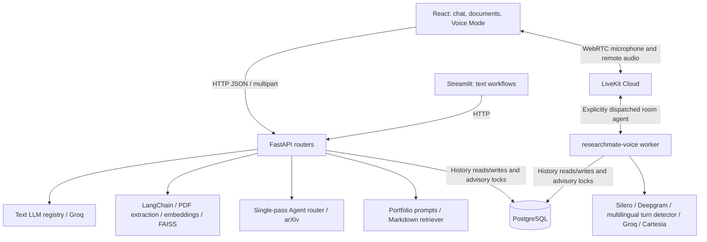
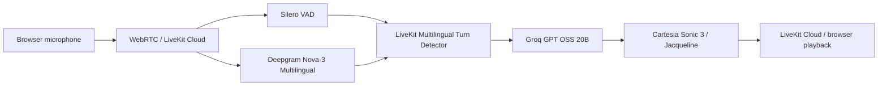
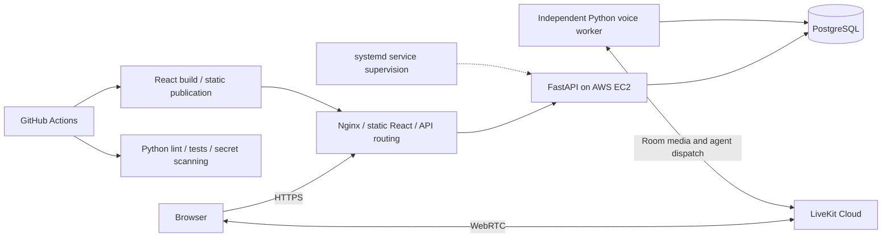

# ResearchMate: Technical Deep Dive

ResearchMate combines text conversation, document retrieval, research discovery, portfolio Q&A, and real-time Voice AI. This document describes the application components, data flow, API contracts, lifecycle guarantees, and operational boundaries. For installation and startup commands, see [README.md](README.md).

## Architecture Overview

React and Streamlit call FastAPI for text workflows. React also connects directly to LiveKit Cloud for voice media after obtaining a room-scoped token from FastAPI. A separate Python worker handles voice conversations. Both Python processes use PostgreSQL for history and cross-process session exclusion.



React builds into static assets independently of Python. `VITE_API_BASE_URL` selects its public API origin at build time. The browser contains HTTP/WebRTC clients and API types; provider secrets, database access, embeddings, and vector indexes remain server-side. Streamlit uses the same text contracts and runs independently through `app.py`.

## Frontend Architecture

React, TypeScript, Vite, Tailwind CSS, and React Router provide the application shell. `SessionProvider` wraps the routed layout, which retains the sidebar and settings across `/`, `/about-chatbot`, and `/about-developer`. Features are grouped under chat, documents, settings, and voice; shared UI and layout components live separately.

### Session state and text requests

Context holds settings and attachment state. Small stores expose snapshots with `useSyncExternalStore`. A page-scoped closure generates one UUID using `crypto.randomUUID()`: navigation and voice/text switching retain it, while a full reload generates another. Only normalized settings survive in `sessionStorage`; conversation IDs, attachments, messages, and LiveKit tokens stay in page memory.

`chatStore.ts` loads history, displays a local user turn, sends a request, and reconciles the result with the persisted snapshot. Routing priority is Agent Mode, attached-document RAG, then Normal Chat. Each submission captures its settings and attachment. Generation and reconciliation are serialized, and failed POSTs are not automatically retried because a message can already be persisted.

arXiv responses remain local because those handlers do not save turns. For document summaries, React preserves the user's wording while matching the fixed summary prompt saved by the backend. Reconciliation compares ordered messages after a known baseline; it does not globally deduplicate identical text, which can represent legitimate repeated questions.

The HTTP client confines requests to the configured origin and handles validation, HTTP, network, timeout, and cancellation errors. Normal requests default to 30 seconds, generation/uploads to 120 seconds, and health checks to five seconds. A voice-completion history read uses a 65-second client deadline to cover the database's 60-second wait limit. API types are compile-time contracts; stores perform selected runtime checks.

PDF selection checks extension, supplied MIME type, and nonempty content. Removing an attachment only detaches it locally. Assistant Markdown uses `react-markdown` and GFM with raw HTML skipped, restricted link protocols, and images represented by alt text.

### Dynamic composer and Voice Mode

`ChatInput.tsx` shows the waveform button when the trimmed input is empty, Agent Mode is off, and no PDF is attached. Otherwise it shows Send. Voice activation is disabled during text requests, document processing, history loading, or unresolved synchronization. While voice is connecting, active, or synchronizing, the workspace disables text submission, Agent Mode, and attachment controls.

`ChatPage.tsx` lazy-loads `VoiceMode.tsx` into the center of the chat workspace. `useVoiceSession.ts` owns token creation, room connection, cancellation, teardown, and history refresh. The official `RoomContext`, `RoomAudioRenderer`, `StartAudio`, and local-participant hooks provide audio playback, browser audio activation, and microphone state. A mutable guard serializes microphone changes, and the button reflects the SDK's actual enabled state.

The orb uses CSS gradients, transforms, breathing glow, and expanding ripples. `useVoiceAssistant` supplies agent states, `useIsSpeaking` supplies local speech activity, and `useTrackVolume` supplies audio amplitude. Agent speaking/thinking states take priority over local activity in the visual state machine. Audio-level updates are isolated in a small component that sets a CSS custom property, avoiding full-interface rerenders on each update. The gradient moves through warm peach, amber, orange, and muted coral tones.

Conversational state labels are implicit in the animation. Visible messages cover connecting, reconnecting, synchronization, and errors; mute is indicated by its control and a dimmed orb. Compact layouts retain the same centered interface. `prefers-reduced-motion` disables motion, transitions, and ripples while retaining controls and state information.

## Backend and API Contracts

`backend/main.py` registers application routers, CORS middleware, and startup initialization. Startup builds the Groq registry and portfolio retriever. `/health` returns an availability response without probing PostgreSQL or providers. Interactive documentation and OpenAPI URLs are disabled in the application configuration.

| Route | Request | Successful response |
| --- | --- | --- |
| `GET /`, `GET /health` | None | Application information or availability status. |
| `POST /chat` | Session ID, message, optional generation settings. | `role`, `content`. |
| `POST /documents/upload` | Multipart PDF in `file`. | `document_id`, `filename`, `status`. |
| `POST /rag/query` | Chat fields plus required `document_id`. | `role`, `content`, empty `sources`. |
| `POST /agent/route` | Chat fields plus optional `document_id`. | `role`, `content`, `intent`, `confidence`, `metadata`. |
| `POST /portfolio/chat` | `session_id`, `message`. | `response`. |
| `POST /voice/session` | `session_id` as a UUID; no extra body fields. | `url`, `room_name`, `token`. |
| `GET /history` | `session_id`; optional `wait_for_idle` boolean. | `session_id`, ordered `messages` with `role` and `content`. |
| `DELETE /history` | `session_id`. | `status: cleared`. |

Text generation settings are `language`, `model_type`, `temperature`, and `max_tokens`. Pydantic constrains temperature to `[0, 1]` and tokens to a positive number; React applies its own 2,048-token ceiling. Text session IDs are nonempty strings, while the voice endpoint requires a valid UUID. React's UUID satisfies both contracts.

Same-session interaction conflicts return **409**. Voice origin rejection returns **403**; invalid request bodies return **422**; rate limits return **429** with `Retry-After`; missing voice configuration, token-signing failure, or lock acquisition/database availability failures can return **503**. Voice admission is a preflight check at token creation and an authoritative lock acquisition in the worker before history loading.

Agent classification and dispatch reside in `backend/api/agent.py`; Portfolio Chatbot routing and prompts reside in its own router. The shared core provides LLM, RAG, history, and dependency-wiring functions.

## AI, RAG, and Evaluation

**Ingestion.** The upload route checks filename, PDF extension, content type when supplied, and nonempty bytes. Core ingestion assigns a UUID, writes the PDF under `data/rag/documents/`, and extracts text with `PyMuPDFLoader`. `RecursiveCharacterTextSplitter` uses **500 characters with 50-character overlap**, not token counts. `all-MiniLM-L6-v2` embeddings feed LangChain's FAISS wrapper. Index files and filename/chunk-count metadata persist under `indexes/` and `metadata/`.

**Answer generation.** Document queries load a persisted index or reuse a process-local retriever cache. The code uses default `as_retriever()` settings for uploaded documents, without an explicit K override. Retrieved chunks are combined with the system prompt and PostgreSQL conversation history through `create_stuff_documents_chain`. The current user message is already in that history. Responses contain text; `/rag/query` returns an empty `sources` array, so the API does not expose extracted citations.

Portfolio retrieval separately embeds Markdown at startup, using the same embedding/chunk settings and an explicit **K=5**. Its route distinguishes greetings, follow-ups, and profile questions, sharing the history infrastructure without using uploaded-document indexes.

**LLM configuration.** Groq hosts `openai/gpt-oss-20b`; the current UI mapping is `GPT OSS`. Defaults are temperature `0.7` and `512` tokens, bound per request around registry clients. `AutoContinueLLM` detects provider length termination or missing terminal punctuation and can append up to two 512-token continuations. This can exceed the initial token setting and misclassify legitimate code/list endings. Although Groq clients enable streaming internally, HTTP routes return completed responses.

The UI offers five languages and passes `language` through requests, but current normal-chat/RAG prompts do not interpolate it. Selecting a language changes welcome text without reliably enforcing answer language. arXiv formatting is English.

**Evaluation.** `eval/run_eval.py` loads the local arXiv benchmark from `pdf/arxiv/`, builds a separate FAISS index, and retrieves ten chunks. Ground truth identifies relevant document sections. The loader implements its own recursive splitting with 500/50 character settings; evaluation embeddings are **`intfloat/e5-base-v2`**, differing from application embeddings.

| Metric | Definition |
| --- | --- |
| Recall@3 / @5 / @10 | Fraction of queries with any relevant chunk within the first K results. |
| MRR | Mean reciprocal rank of the first relevant chunk. |
| Average groundedness | Answer-token overlap with retrieved context after normalization. |
| Grounded ratio | Fraction of answers meeting the overlap threshold. |

The evaluator writes aggregate and optional per-query output to [eval/results.json](eval/results.json) or a selected output path. Application and evaluation embedding models differ, so benchmark output does not directly characterize the application's retriever.

Current groundedness tokenizes ASCII alphanumeric words, removes stopwords, and uses a **0.20** overlap threshold. Empty tokenized answers score 1.0. This heuristic cannot establish factual correctness or semantic faithfulness and is unsuitable as multilingual quality evidence. Generation errors are recorded per query, so counts matter. The dataset is Git-ignored and must be supplied separately. `--skip-generation` runs retrieval only; `--include-details` records per-query output.

## Agent Workflow

The implementation is a single dispatch pipeline, with no planning loop, tool recursion, or result-driven replanning:

1. Rule checks recognize greetings, very short input, and selected generic replies.
2. Otherwise, one classifier invocation searches the returned text for an allowed intent. It sees the message and document-presence flag, not conversation history.
3. The selected Python handler runs and assembles content, intent, confidence, and metadata.

| Capability | Implementation |
| --- | --- |
| Chat / fallback | Use normal chat with persisted history. Unrecognized classifier output selects fallback; missing-document RAG classifications redirect to chat. |
| Document Q&A | Load the selected retriever and run the shared RAG chain. |
| Summary | Replace the request with a fixed summary instruction, save it, and query the same retriever. Coverage is limited to retrieved chunks. |
| arXiv search | Remove common request phrases; request up to five results sorted by submission date. |
| Recommendations | Extract a topic and search arXiv by relevance, without personalized ranking. |

Confidence values are assigned constants, not calibrated probabilities. arXiv results contain bibliographic information and abstract excerpts; handlers do not download and analyze paper bodies. Search exceptions become empty results, conflating failures with no matches. Neither arXiv handler persists turns. The routing path has one classifier invocation, but its continuation wrapper means total provider calls are not strictly capped at two.

## Voice AI Pipeline

The worker in [backend/voice/agent.py](backend/voice/agent.py) uses LiveKit Agents **1.8.13** and matching provider plugins. LiveKit Cloud carries room media; the browser's WebRTC connection bypasses the text HTTP generation routes.



| Stage | Implementation |
| --- | --- |
| Speech activity | Silero VAD is loaded during worker process initialization. |
| Transcription | Deepgram `nova-3`, `language=multi`, with interim results enabled. |
| Turn completion | LiveKit `MultilingualModel` combines conversational context with speech activity; fixed endpointing uses a 0.5-second minimum and 3-second maximum. |
| Interruption | SDK VAD-based interruptions are enabled, with false-interruption resumption. Preemptive generation is disabled. |
| Language model | LiveKit's OpenAI-compatible plugin calls Groq's `openai/gpt-oss-20b`, with low reasoning effort and a 1,024-token completion limit. |
| Speech synthesis | Cartesia `sonic-3` uses the Jacqueline voice; automatic language behavior is the default. |
| Spoken output | Speech-friendly instructions favor concise responses. Markdown, emoji, and URLs are filtered; reasoning content is excluded from spoken content/history. |

The voice pipeline has its own fixed model settings and instructions. Text temperature/token controls do not reconfigure it. It supports general conversation and has no uploaded-document retrieval or Agent Mode tools. Multilingual transcription and speech output are distinct from the five-choice text-language selector.

### Room creation, tokens, and dispatch

`POST /voice/session` validates the application UUID, configured LiveKit URL, allowed origin, rate limit, and session availability. It generates a unique room name and participant identity for each connection. The endpoint signs a token locally; joining with that token supplies room configuration to LiveKit, including an explicit dispatch to **`researchmate-voice`**.

The token has a **five-minute join lifetime** and grants room join, subscription, and microphone publication. Data publication, participant-metadata changes, administrative actions, room listing/creation/recording privileges, and agent-management permissions are disabled. Its response is marked `no-store`, and the response model excludes the token from its representation.

Dispatch metadata contains the ResearchMate `session_id`. The worker reads `ctx.job.metadata`, validates application metadata, acquires the session lock, and loads stored context before connecting its conversation pipeline. It does not accept application context from participant-controlled metadata. Blank metadata, or standalone metadata without an application session field, enables console/Playground use without database persistence; malformed application metadata is rejected.

Token issuance does not reserve an unused session for the token's lifetime. Competing tokens can exist before worker admission, but the worker's atomic lock permits only one active same-session interaction. Token expiration prevents a new join with an expired token; it does not enforce a maximum running conversation duration.

```mermaid
sequenceDiagram
    participant R as React
    participant A as FastAPI
    participant L as LiveKit Cloud
    participant W as Voice worker
    participant P as PostgreSQL
    R->>A: POST /voice/session with conversation UUID
    A->>P: Try session lock for admission check
    P-->>A: Available or conflict
    A-->>R: Room-scoped token and URL; release admission lock
    R->>L: Join room and publish microphone
    L->>W: Dispatch researchmate-voice with session metadata
    W->>P: Acquire session lock and load history
    loop Conversation
        R->>L: User audio
        L->>W: Room media
        W->>L: Synthesized speech
        L->>R: Remote audio
        W->>P: Commit ordered user/assistant messages
    end
    R->>L: Disconnect and stop local media
    R->>A: GET /history with wait_for_idle=true
    A->>P: Wait for session lock
    L->>W: Participant disconnect lifecycle
    W->>W: Close conversation and drain queued writes
    W->>P: Release lock
    P-->>A: Acquire lock and read completed history
    A-->>R: One history snapshot
```

## PostgreSQL History and Concurrency

`chat_messages` stores a generated ID, session ID, constrained role, text content, and timestamp. SQLAlchemy Core uses parameterized queries and orders messages by **creation time, then ID**. Every history operation receives a session ID explicitly. The shared store retains the engine/pool; an interaction's bound store owns its checked-out connection.

### Cross-process exclusion

A deterministic 64-bit hash of the session ID is the key for a PostgreSQL **session-level advisory lock**. A text request uses `pg_try_advisory_lock` before generation and retains ownership through its writes. The voice worker acquires the same lock before reading context and retains it throughout the conversation and graceful shutdown. Session-level locks survive message commits. Different session IDs proceed independently.

The lock connection is checked out from the existing SQLAlchemy pool and uses autocommit. History operations for the owning interaction use that same connection. Invalid or closed connections are rejected instead of transparently continuing writes on a replacement connection without ownership. Cleanup unlocks before returning the connection to the pool; connection/process termination also releases ownership when PostgreSQL observes disconnection. Each active interaction occupies one pool connection.

Chat, RAG, Agent, and Portfolio generation use the shared exclusion dependency. History clearing also requires the lock; ordinary history retrieval remains available while a conversation is active. `wait_for_idle=true` waits on the advisory lock before reading, with a 60-second database statement deadline. The worker has no separate process-local authority to override a database conflict.

### Shared text and voice context

Text inserts and assistant inserts commit separately, so a failed generation can leave a user-only turn. Text prompt conversion maps `user`/`assistant` roles to LangChain's human/AI representations. The voice worker loads nonempty user/assistant messages into a LiveKit `ChatContext`, preserving their stored order while excluding stored system instructions.

The worker's `conversation_item_added` handler persists **committed conversation items**, not interim transcription events. An asynchronous queue feeds one writer, which offloads synchronous database work with `asyncio.to_thread`. This keeps SQL work off the audio event loop and preserves write order. Message IDs already loaded or observed are tracked to prevent duplicate inserts. Identical text with different message IDs remains a valid separate turn.

The automatic welcome greeting uses `add_to_chat_ctx=False`. System instructions, reasoning fields, partial transcripts, raw audio, and the greeting are excluded from persisted conversation messages. For interrupted assistant speech, the handler requires synchronized playback evidence for the current speech ID and saves the committed spoken portion. If that evidence is unavailable, it skips the interrupted response instead of storing the full unheard generation. SDK playback acknowledgment is not proof of physical speaker audibility.

A write failure closes the application voice session. Automatic database retries are disabled because an insert can commit before an error reaches the client; blindly retrying can duplicate it. During graceful shutdown, `session.aclose()` commits final conversation items, the writer drains, providers close, and only then does the lock release. The shutdown task and lock-checkout task are shielded so cancellation cannot release ownership ahead of outstanding writes. Forced process termination releases the lock but cannot preserve uncommitted queued text.

React refreshes through the existing chat store once voice teardown completes. The `wait_for_idle` history request waits for worker completion instead of using fixed sleeps or repeated snapshot polling. A pending-history flag survives chat-page navigation and triggers reconciliation on return. The persisted snapshot replaces the displayed history, avoiding duplicated local voice turns.

## Interruption Handling and Session Lifecycle

LiveKit handles speech interruption, transcription synchronization, and false-interruption resumption. The frontend does not introduce another VAD, turn detector, or audio interruption controller. CSS state changes only visualize the SDK conversation.

`useVoiceSession.ts` tracks idle, connecting, connected, and synchronizing phases. An attempt reference blocks duplicate starts. Abort controllers cancel token requests, and room ownership/generation checks prevent callbacks from a closed session from changing a newer one. The SDK manages connection retry/reconnection; the orb displays reconnecting state. A connected room without a ready agent is closed after a 30-second frontend availability wait with a recoverable error.

Ending voice immediately stops local published tracks and detaches remote audio before awaiting SDK network teardown. Navigation, unmount, and page exit use the same media cleanup principles. Delayed microphone acquisition is followed by SDK cleanup if the attempt has already closed. Permission failures, token errors, worker unavailability, and terminal connection loss restore the workspace through the existing error and reconciliation paths.

Microphone changes are serialized and invoke `setMicrophoneEnabled`; SDK participant state determines the button label and pressed state. Browser autoplay restrictions are handled by `StartAudio`. The worker disables recording explicitly and rejects the recording CLI option.

## Python Environments and Dependency Management

The API and worker use separate Python environments as shown in the README, with both installing [requirements.txt](requirements.txt). This shared pinned manifest includes FastAPI/Uvicorn, text/RAG dependencies, SQLAlchemy/psycopg2, LiveKit Agents/provider plugins, and `livekit-api` for token signing. Separate interpreters isolate process dependencies and worker model caches; the manifest supplies the same package set to each.

`python-dotenv` loads root configuration, with existing shell values taking precedence in the voice worker. `GROQ_API_KEY` is shared by the two inference paths; LiveKit, Deepgram, and Cartesia credentials are needed for voice. Optional Cartesia overrides are described in the README. Model assets are downloaded for the worker environment; without an override, its Hugging Face cache is associated with that interpreter environment.

`package.json` and `package-lock.json` define the independent frontend installation. `livekit-client` and `@livekit/components-react` are runtime dependencies. Playwright is development-only, and its configuration/test sources are included in TypeScript checks. Build/test artifacts and environments are ignored by Git.

## Security and Privacy Boundaries

| Area | Implemented behavior and limit |
| --- | --- |
| Provider credentials | Server-side environment variables; only the public API origin belongs in React's `VITE_*` configuration. |
| Voice authorization | Short-lived, room-scoped participant token, restricted publication grants, explicit agent dispatch, and UUID validation. |
| Origin handling | `/voice/session` requires an origin in `VOICE_ALLOWED_ORIGINS`, validates preflight requests, and returns non-cacheable responses. General API CORS remains wildcard-configured. |
| Abuse limits | Configurable per-client and global token-creation counters with a fixed window, held separately in each API process. These are not a shared multi-instance quota. |
| Proxy headers | The limiter uses the ASGI client address and ignores forwarding headers itself. Actual client-IP attribution depends on the trusted-proxy configuration of the ASGI server/proxy. |
| Conversation ownership | Session UUIDs are grouping keys, not authentication. Conversation and document ownership are not enforced by an account or anonymous credential mechanism. |
| SQL concurrency | Advisory locks prevent concurrent same-session application interactions; they do not authenticate the caller or provide transaction-wide rollback of a conversation. |
| Audio and transcripts | Session recording is disabled. Committed transcript text is persisted, and worker diagnostics log final user/assistant text. Provider processing and transcript logging remain privacy considerations. |
| Error disclosure | Token-signing errors are sanitized, tokens are hidden from response-model representations, and the worker formatter redacts configured credentials. Some text/database exception responses still contain raw exception details. |
| File handling | Uploaded PDFs and vector indexes use server-managed local storage. Upload routes have no explicit size cap; FAISS loading enables pickle deserialization and requires trusted files. |

There is no application-enforced maximum voice conversation duration: token join expiry and session duration are different controls. History has no retention or context-window pruning policy in the store, and document removal in the UI does not remove stored files. These boundaries are relevant when operating the application with public access or sensitive research material.

## Testing Strategy

| Suite | Coverage and execution boundary |
| --- | --- |
| `tests/test_health.py` | Health contracts, explicit-session history operations, and concurrent independent API sessions using SQLite and mocked generation. |
| `tests/test_voice.py` | Voice token claims/expiry, room uniqueness, dispatch metadata, origin checks, rate limits, configuration errors, and sensitive token handling with mocked credentials. |
| `tests/test_voice_history.py` | History/context loading, committed item persistence, duplicate suppression, interrupted spoken text, session isolation, failures, and shutdown write ordering using SQLite/mocked session events. |
| `tests/test_session_concurrency.py` | Opt-in PostgreSQL tests for same-session contention, independent sessions, duplicate workers, completion reads, failed/lost connections, process termination, and cancellation during shutdown/startup. |
| `react-frontend/tests/voice.spec.ts` | Composer routing, disabled states, orb SDK states/volume, reduced motion, mobile layout, microphone errors, cancellation, stale callbacks, cleanup/navigation/reload, conflicts, and single-snapshot history refresh. |

Default browser tests mock HTTP signaling and microphone publication while using SDK participants, hooks, and synthesized audio tracks. They do not establish end-to-end provider or production validation. The opt-in live-media smoke test uses the real token API, WebRTC, microphone capture, and agent audio, with synthetic silence and an external provider call.

Use the README's lint, pytest, TypeScript, Playwright, and build commands. `RUN_POSTGRES_TESTS=1` enables the configured-database suite; its disposable session data is cleaned up. `VOICE_LIVE_TEST=1` enables the live-media browser test. The latter requires a locally running API at the address configured in `playwright.config.ts` and a registered voice worker; configure the API's allowed voice origins to include the test browser origin. Keep these test settings local rather than substituting hosted infrastructure details in source.

The RAG evaluator is separate from regression tests. It requires the ignored local benchmark dataset and embedding assets, and answer generation requires Groq access. Its lexical groundedness heuristic does not establish factual correctness, semantic faithfulness, or multilingual quality.

## High-Level Deployment and CI/CD



Public application entry points are [researchmate.me](https://researchmate.me/) and [api.researchmate.me](https://api.researchmate.me/). The application architecture separates HTTPS application traffic from LiveKit's media transport. PostgreSQL supplies shared history and locks, while per-document PDFs/indexes remain local to the application storage layer. Scaling across application hosts requires a consistent file/index storage strategy as well as shared PostgreSQL and coordinated admission capacity.

[deploy.yml](.github/workflows/deploy.yml) runs Ruff and pytest using Python 3.11. Its gated EC2 deployment job installs frontend packages with `npm ci`, builds and publishes React assets, restarts the FastAPI systemd service, validates Nginx, and runs HTTPS reachability checks against the frontend and API health endpoints. It does not install backend/worker Python dependencies, migrate the schema, or start/restart the voice worker. The workflow does not run the Playwright suite or verify a complete voice conversation.

[secret-scan.yml](.github/workflows/secret-scan.yml) runs Gitleaks for repository secret detection. CI check definitions and local regression suites describe the checks the project provides; they are not evidence of a particular live installation, provider latency, availability target, or voice-quality score.
