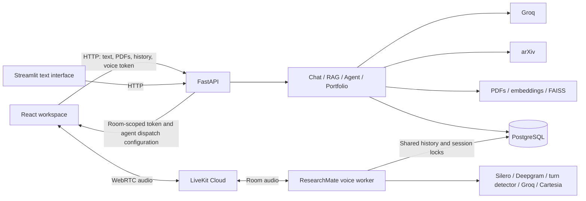

# ResearchMate

**An AI research assistant for text and voice conversations, PDF question answering, and research paper discovery.**

ResearchMate combines a React workspace with FastAPI, Groq-hosted language models, retrieval-augmented generation (RAG), and PostgreSQL conversation history. Read and discuss research through text, upload a PDF for document questions, discover papers through Agent Mode, or continue a Normal Chat conversation by voice.

React and Streamlit coexist as independently runnable interfaces. React provides Voice Mode; Streamlit uses the text APIs.

[Project website](https://researchmate.me/) · [API health](https://api.researchmate.me/health) · [Repository](https://github.com/miteshgupta07/ResearchMate) · [Technical deep dive](PROJECT_DEEP_DIVE.md) · [MIT License](LICENSE)

## Features

| Capability | Behavior |
| --- | --- |
| **Normal Chat** | Conversational responses with session-based PostgreSQL history. |
| **Document Q&A (RAG)** | Upload a PDF, extract and chunk its text, build a persistent FAISS index, and answer questions using retrieved context. One document is attached at a time. |
| **Agent Mode** | A single-pass router selects chat, document Q&A, document summarization, arXiv search, or topic-based paper recommendations. |
| **Research paper discovery** | arXiv results include paper information, abstract excerpts, and paper/PDF links. |
| **Document summarization** | Agent Mode summarizes retrieved document chunks; it does not perform a dedicated pass over every page. |
| **Voice AI** | Real-time multilingual conversations over WebRTC, with speech activity detection, multilingual turn detection, natural interruptions, and spoken responses. |
| **Shared text/voice context** | Normal Chat and Voice Mode use the same conversation UUID and stored history, so either can continue the other's committed turns. |
| **Voice interface** | A warm animated gradient orb responds to audio and agent state. Microphone mute/unmute, connection messages, and an end-conversation control support the session lifecycle. Animations respect reduced-motion preferences. |
| **Chat settings** | Temperature from 0 to 1 and maximum tokens from 1 to 2,048. The text model option **GPT OSS** maps to Groq's `openai/gpt-oss-20b`. |
| **Language settings** | English, Hindi, Spanish, French, and German welcome text and a language setting for text requests. Voice uses multilingual transcription and speech-friendly instructions that follow the speaker's language. |
| **React workspace** | Responsive layout, Markdown/GFM answers, PDF controls, loading/error states, and About Chatbot / About Developer pages. |
| **Response continuation** | The text LLM wrapper can request bounded continuations when generation is detected as truncated. |
| **Portfolio Chatbot** | A separate API answers developer-profile questions using the Markdown knowledge base in `portfolio_kb/`. |

**Voice Mode is available only in Normal Chat**, with an empty composer, Agent Mode disabled, and no attached PDF. RAG and Agent Mode remain text-only. Text requests, uploads, history synchronization, and voice connections are coordinated to prevent concurrent interactions in the same conversation.

Chat settings persist in browser session storage. Conversation IDs, messages, and attachments remain in page memory: **refreshing starts a new conversation**, while previous messages remain under their original database session ID. The UI does not provide an archive of past sessions.

## Technology Stack

| Layer | Technologies |
| --- | --- |
| React frontend | React, TypeScript, Vite, Tailwind CSS, React Router |
| Answer rendering | `react-markdown`, `remark-gfm` |
| Alternative frontend | Streamlit and its Python HTTP client |
| Backend | FastAPI, Uvicorn, Pydantic |
| Text inference | Groq GPT OSS 20B through `langchain-groq` |
| Voice transport/orchestration | LiveKit Agents, LiveKit Cloud, WebRTC, LiveKit React/client SDKs |
| Voice pipeline | Silero VAD → Deepgram Nova-3 Multilingual → LiveKit Multilingual Turn Detector → Groq GPT OSS 20B → Cartesia Sonic 3, using the Jacqueline voice |
| RAG | LangChain Classic / Community, recursive character splitting, PyMuPDF |
| Embeddings and vector search | Hugging Face Sentence Transformers `all-MiniLM-L6-v2`, FAISS CPU |
| Persistence | PostgreSQL, SQLAlchemy Core, psycopg2 |
| Paper discovery | arXiv Python client |
| Testing and CI | pytest, Ruff, TypeScript, ESLint, Playwright, GitHub Actions, Gitleaks |

Python dependencies are pinned in [requirements.txt](requirements.txt). Frontend dependencies and their lockfile live in `react-frontend/`; Playwright is development-only.

## System Architecture



FastAPI and the voice worker run as separate Python processes. PostgreSQL advisory locks serialize same-session interactions across them. The worker loads history before speaking and drains committed history writes during graceful shutdown. React then requests one history snapshot that waits for the session lock to become available.

React accesses application services over HTTP and voice media through LiveKit. It does not import Python code, access PostgreSQL or FAISS directly, or hold provider API secrets. See [PROJECT_DEEP_DIVE.md](PROJECT_DEEP_DIVE.md) for lifecycle, persistence, API, and security details.

## Project Structure

```text
ResearchMate/
|-- react-frontend/
|   |-- src/app/             # Routing and browser session context
|   |-- src/components/      # Layout, shared UI, About components
|   |-- src/features/        # Chat, documents, settings, Voice Mode
|   |-- src/services/api/    # HTTP client and endpoint helpers
|   |-- src/types/           # TypeScript API contracts
|   |-- tests/               # Playwright voice and chat regressions
|   `-- package.json
|-- backend/
|   |-- main.py              # FastAPI entry point
|   |-- api/                 # Chat, RAG, Agent, Portfolio, history, voice tokens
|   |-- schemas/             # Pydantic API contracts
|   |-- core/                # LLM services, RAG, PostgreSQL history and locks
|   |-- voice/agent.py       # Independent LiveKit voice worker
|   `-- schema.sql          # Conversation table definition
|-- app.py                   # Streamlit entry point
|-- views/                   # Streamlit pages
|-- streamlit_frontend/      # Streamlit API client and styling
|-- portfolio_kb/            # Portfolio Markdown knowledge base
|-- tests/                   # Backend and database regression tests
|-- eval/                    # Dataset loader, metrics, evaluation runner
|-- .github/workflows/       # Application checks, deployment, secret scanning
|-- requirements.txt
|-- PROJECT_DEEP_DIVE.md
`-- LICENSE
```

PDFs, indexes, metadata, benchmark datasets, model caches, virtual environments, and generated test/build output are local runtime artifacts, not application source supplied by a fresh clone.

## Installation & Local Setup

### 1. Install dependencies in separate Python environments

Use Python 3.11, PostgreSQL, and Node.js 22.13+ on the 22.x line or Node.js 24+. Voice requires a LiveKit Cloud project and Groq, Deepgram, and Cartesia credentials. Initial setup requires internet access for dependencies and embedding/voice model assets.

From the repository root:

```bash
git clone https://github.com/miteshgupta07/ResearchMate.git
cd ResearchMate
python -m venv venv
python -m venv .venv
```

PowerShell installation:

```powershell
.\venv\Scripts\python.exe -m pip install -r requirements.txt
.\.venv\Scripts\python.exe -m pip install -r requirements.txt
```

On macOS/Linux, use `venv/bin/python` and `.venv/bin/python` instead. Both environments install the same shared manifest; the repository does not use a separate voice requirements file. Separate environments isolate the API and worker processes without changing the pinned dependency set. Building `psycopg2` from source can require PostgreSQL development libraries and compiler tools.

### 2. Configure local environment variables

Create a root `.env` using **your own values**. These placeholders describe local setup, not hosted infrastructure:

```dotenv
GROQ_API_KEY=replace_with_groq_key
LIVEKIT_URL=wss://replace_with_livekit_project_host
LIVEKIT_API_KEY=replace_with_livekit_key
LIVEKIT_API_SECRET=replace_with_livekit_secret
DEEPGRAM_API_KEY=replace_with_deepgram_key
CARTESIA_API_KEY=replace_with_cartesia_key
DB_HOST=replace_with_local_database_host
DB_PORT=replace_with_local_database_port
DB_NAME=replace_with_local_database_name
DB_USER=replace_with_local_database_user
DB_PASSWORD=replace_with_local_database_password
BASE_URL=http://localhost:8000
VOICE_ALLOWED_ORIGINS=http://localhost:5173,http://127.0.0.1:5173
VOICE_RATE_LIMIT_REQUESTS=5
VOICE_RATE_LIMIT_WINDOW_SECONDS=60
VOICE_RATE_LIMIT_GLOBAL_REQUESTS=60
```

`GROQ_API_KEY` serves both text and voice inference. The voice worker loads the root `.env`; shell values take precedence. Optional `CARTESIA_VOICE_ID` and `CARTESIA_LANGUAGE` override the default Jacqueline voice and automatic language behavior. Include the public frontend origin in `VOICE_ALLOWED_ORIGINS` when serving the application over HTTPS.

Create `react-frontend/.env` with only public configuration:

```dotenv
VITE_API_BASE_URL=http://localhost:8000
```

Never put provider/database credentials in `VITE_*` variables: Vite embeds them in browser assets. Restart Vite after changing local configuration; production API configuration is selected at build time.

Create the configured local PostgreSQL database and execute [backend/schema.sql](backend/schema.sql) once through your PostgreSQL client. It defines `chat_messages` and is not an idempotent migration.

### 3. Start the application

Run each command in a separate terminal from the repository root. Addresses below are local development examples.

**FastAPI:**

```powershell
.\venv\Scripts\python.exe -m uvicorn backend.main:app --reload --port 8000
```

`http://localhost:8000/health` returns `{"status":"healthy"}`. Startup initializes the LLM registry and portfolio retriever. Health checks report API availability, not database or provider readiness.

**Voice worker:**

```powershell
.\.venv\Scripts\python.exe -m backend.voice.agent download-files
.\.venv\Scripts\python.exe -m backend.voice.agent dev
```

The worker registers as `researchmate-voice` with the configured LiveKit project. For standalone local audio testing, use `python -m backend.voice.agent console` in the voice environment; without application dispatch metadata, it does not read or write conversation history.

**React:**

```bash
cd react-frontend
npm ci
npm run dev
```

Open the URL printed by Vite, normally `http://localhost:5173`. Voice needs microphone permission and a secure browser context: HTTPS or localhost. `npm run build` produces static assets; `npm run preview` serves a local build preview. Static hosting needs an `index.html` fallback for React Router.

**Optional Streamlit interface:**

```powershell
.\venv\Scripts\python.exe -m streamlit run app.py
```

Streamlit uses `BASE_URL` to reach FastAPI and can run alongside React.

## API Overview

| Method | Endpoint | Purpose |
| --- | --- | --- |
| `GET` | `/`, `/health` | Application information and availability. |
| `POST` | `/chat` | Normal conversation with persisted history. |
| `POST` | `/documents/upload` | Multipart PDF `file`; returns `document_id`, `filename`, and processing status. |
| `POST` | `/rag/query` | Document Q&A using `document_id`. |
| `POST` | `/agent/route` | Single-pass capability routing with intent, confidence, and metadata. |
| `POST` | `/portfolio/chat` | Portfolio questions; returns a `response` field. |
| `POST` | `/voice/session` | Conversation UUID in; LiveKit `url`, unique `room_name`, and room-scoped `token` out. |
| `GET` | `/history?session_id=...` | Retrieve one conversation. Add `wait_for_idle=true` to wait for committed writes. |
| `DELETE` | `/history?session_id=...` | Clear an idle conversation; active interactions return `409`. |

Chat, RAG, and Agent requests accept `session_id`, `message`, and optional language/model/generation settings. RAG requires `document_id`; Agent accepts it optionally. Text endpoints return completed HTTP responses. RAG's `sources` array is empty; extracted source citations are not part of its response contract.

Voice tokens expire after five minutes for joining a room; this is not a running-session duration limit. The endpoint requires an allowed browser origin and applies configurable, process-local rate limits. Session UUIDs group history but do not establish ownership; see the deep dive's security limitations.

## Evaluation & Testing

The [evaluation runner](eval/) uses a locally supplied arXiv benchmark, separate FAISS retrieval, Recall@K hit rates, MRR, and lexical answer/context overlap. Evaluation embeddings (`intfloat/e5-base-v2`) differ from application embeddings (`all-MiniLM-L6-v2`), so evaluator results are not direct application-quality guarantees.

```bash
python -m eval.run_eval --help
python -m eval.run_eval --max-queries 50 --skip-generation
python -m ruff check backend tests
python -m pytest -q
python -m pip check
```

Run Python checks in the API environment and `pip check` in both environments. To include tests against your configured PostgreSQL instance, set `RUN_POSTGRES_TESTS=1`; they use disposable session IDs and remove their test messages.

From `react-frontend/`:

```bash
npm ci
npx playwright install chromium
npm run lint
npx tsc -b
npm test
npm run build
```

Playwright covers composer behavior, audio-responsive states, reduced motion, session cleanup, conflict handling, and history synchronization. Live-media testing is opt-in and requires the API and a registered worker; see [the deep dive](PROJECT_DEEP_DIVE.md#testing-strategy).

## Deployment & CI/CD

The high-level hosting architecture uses **AWS EC2, Nginx, HTTPS, PostgreSQL, systemd, and GitHub Actions**. Public entry points are [researchmate.me](https://researchmate.me/) and [api.researchmate.me](https://api.researchmate.me/). React serves static assets, FastAPI handles application requests, and the independent voice worker connects to LiveKit Cloud for WebRTC sessions.

[deploy.yml](.github/workflows/deploy.yml) runs Python lint/tests and includes a gated deployment job that builds and publishes React assets, restarts FastAPI under systemd, validates Nginx configuration, and checks the public HTTPS endpoints. [secret-scan.yml](.github/workflows/secret-scan.yml) runs Gitleaks. The workflow does not install server-side Python dependencies, migrate PostgreSQL, or manage the voice worker lifecycle; those are separate operational responsibilities. Workflow checks do not validate a complete voice conversation.

## Developer & Project Links

Created by **Mitesh Gupta**.

- [ResearchMate website](https://researchmate.me/)
- [GitHub repository](https://github.com/miteshgupta07/ResearchMate)
- [Developer portfolio](https://miteshgupta-portfolio.vercel.app/)
- [GitHub profile](https://github.com/miteshgupta07)
- [Email](mailto:miteshgupta2711@gmail.com)
- [Technical deep dive](PROJECT_DEEP_DIVE.md)

Contributions are welcome. Open an issue to discuss substantial changes and preserve both frontends and the API contracts. ResearchMate is released under the [MIT License](LICENSE), copyright Mitesh Gupta.
