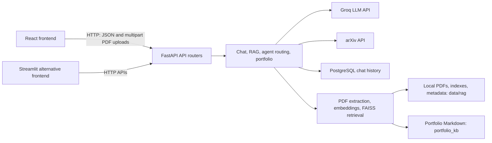

# ResearchMate

**An AI research assistant for conversational chat, PDF question answering, and research paper discovery.**

ResearchMate combines a React workspace with a FastAPI backend for retrieval-augmented generation (RAG), Groq-hosted language models, and PostgreSQL-backed conversation history. Upload a paper, ask questions about its content, or enable Agent Mode to route requests to document analysis and arXiv discovery.

The new **React frontend and existing Streamlit application coexist**. Both use the same FastAPI APIs, and Streamlit remains independently runnable as an alternative interface.

[Project website](https://researchmate.me/) · [Repository](https://github.com/miteshgupta07/ResearchMate) · [Technical deep dive](PROJECT_DEEP_DIVE.md) · [MIT License](LICENSE)

## Features

| Capability | Current behavior |
| --- | --- |
| **Normal Chat** | Conversational responses with session-based message history. |
| **Document Q&A (RAG)** | Upload a PDF, extract and chunk its text, build a persistent FAISS index, and answer questions using retrieved context. One attached document is used at a time. |
| **Agent Mode** | Classifies a request and routes it to one capability: chat, document Q&A, document summarization, arXiv search, or topic-based paper recommendations. Uses a single-pass router. |
| **Research paper discovery** | Search arXiv or request recommendations in Agent Mode; results include paper information, abstract excerpts, and paper/PDF links. |
| **Document summarization** | Ask Agent Mode to summarize an uploaded document. Summaries use retrieved chunks, rather than a dedicated pass over every page. |
| **Chat settings** | Adjust temperature from 0 to 1 and maximum tokens from 1 to 2,048. The current model option is **GPT OSS**, mapped to `openai/gpt-oss-20b` through Groq. |
| **Multilingual responses** | Select English, Hindi, Spanish, French, or German for AI answers and welcome messages. arXiv result formatting remains English. |
| **Conversation history** | FastAPI stores messages in PostgreSQL and exposes retrieval and clearing by session ID. React loads history for its active session. |
| **React workspace** | Responsive layout, Markdown/GFM answer rendering, PDF attachment controls, loading/error states, and About Chatbot / About Developer pages. |
| **Response continuation** | The backend LLM wrapper can request bounded continuations when generation is detected as truncated. |
| **Portfolio API** | A separate backend route answers developer questions using the Markdown knowledge base in `portfolio_kb/`. |

React retains chat settings in browser session storage, but conversation IDs, messages, and attachments stay in memory. **Refreshing the page starts a new conversation**; previous messages remain in the database under their original session ID. The UI does not provide an archive of previous sessions.

Document Q&A currently returns an empty `sources` array reserved for future use; extracted source citations are not yet available. Chat responses are returned as complete HTTP responses, without a token-streaming API.

## Tech Stack

| Layer | Technologies used |
| --- | --- |
| React frontend | React, TypeScript, Vite, Tailwind CSS, React Router |
| Answer rendering | `react-markdown`, `remark-gfm` |
| Alternative frontend | Streamlit, Python HTTP client |
| HTTP backend | FastAPI, Uvicorn, Pydantic |
| LLM inference | Groq via `langchain-groq`; GPT OSS (`openai/gpt-oss-20b`) |
| RAG orchestration | LangChain Classic / Community, recursive character splitting |
| Application embeddings | Hugging Face Sentence Transformers: `all-MiniLM-L6-v2` |
| Vector search | FAISS CPU with indexes persisted on disk |
| PDF extraction | PyMuPDF through LangChain's PDF loader |
| Persistence | PostgreSQL, SQLAlchemy Core, psycopg2 |
| Paper discovery | arXiv Python client |
| Development and CI | ESLint, TypeScript, Ruff, pytest, GitHub Actions, Gitleaks |

Hugging Face supplies embedding models; the current LLM implementation uses Groq. Dependencies are declared in [requirements.txt](requirements.txt), [requirements-test.txt](requirements-test.txt), and [react-frontend/package.json](react-frontend/package.json).

## System Architecture

React communicates with FastAPI **exclusively through HTTP APIs**. API services and TypeScript request/response types live inside `react-frontend/`; the browser does not import Python modules or directly access PostgreSQL, FAISS, backend files, or provider credentials.



FastAPI validates requests, delegates to core services, and persists conversation messages. PDF ingestion uses 500-character chunks with 50-character overlap. Uploaded PDFs, document indexes, and metadata live under `data/rag/`; the portfolio retriever is built at API startup from `portfolio_kb/`.

React builds independently into static assets. `VITE_API_BASE_URL` selects the backend origin, allowing the frontend and API to run or deploy separately. See [PROJECT_DEEP_DIVE.md](PROJECT_DEEP_DIVE.md) for longer technical background; some older model, setup, and evaluation descriptions there predate this README.

## Project Structure

```text
ResearchMate/
|-- react-frontend/          # Independently runnable React application
|   |-- src/
|   |   |-- app/            # Navigation and browser session context
|   |   |-- components/     # Shared layout, UI, and About components
|   |   |-- features/       # Chat, PDF documents, and settings
|   |   |-- pages/          # Chat, About Chatbot, About Developer
|   |   |-- services/api/   # HTTP client and endpoint helpers
|   |   `-- types/          # TypeScript API contracts
|   |-- public/             # Static assets
|   |-- package.json
|   `-- vite.config.ts
|-- backend/
|   |-- main.py             # FastAPI entry point and router registration
|   |-- api/                # Chat, RAG, documents, agent, history, portfolio
|   |-- schemas/            # Pydantic request/response models
|   |-- core/               # LLM services, RAG, database config, chat history
|   |-- schema.sql          # chat_messages table definition
|   `-- init_db.py          # Legacy initializer; see setup caveat below
|-- app.py                  # Streamlit entry point
|-- views/                  # Streamlit pages
|-- streamlit_frontend/     # Streamlit API client and styling utilities
|-- portfolio_kb/           # Markdown knowledge base for the portfolio API
|-- eval/                   # Dataset loader, metrics, evaluation runner
|-- pdf/arxiv/              # Local benchmark data; ignored by Git
|-- data/rag/               # Runtime PDFs, indexes, metadata; ignored by Git
|-- .github/workflows/      # Python checks, EC2 deployment, secret scanning
|-- requirements.txt
|-- requirements-test.txt
|-- PROJECT_DEEP_DIVE.md
`-- LICENSE
```

`pdf/arxiv/` and `data/rag/` are local data locations, not files supplied by a fresh clone. A `tests/` directory is referenced in project guidance, but is absent from this branch's checkout.

## Installation & Local Setup

### Prerequisites

- **Python 3.11**, matching the GitHub Actions environment, and a virtual environment.
- **Node.js 22.13+ on the 22.x line, or Node.js 24+**, with npm, satisfying the installed Vite and ESLint engine requirements.
- A running **PostgreSQL** server, with `createdb` and `psql` available for the setup below.
- A **Groq API key** for LLM requests.
- Internet access for initial embedding model downloads and external Groq/arXiv requests. Installing `psycopg2` from source may require PostgreSQL development libraries and compiler tools.

### 1. Clone and install Python dependencies

```bash
git clone https://github.com/miteshgupta07/ResearchMate.git
cd ResearchMate
git switch feature/react-frontend
python -m venv venv
```

Activate the virtual environment:

```powershell
# Windows PowerShell
.\venv\Scripts\Activate.ps1
```

```bash
# macOS / Linux
source venv/bin/activate
```

From the repository root:

```bash
python -m pip install -r requirements.txt -r requirements-test.txt
```

`requirements-test.txt` also declares SQLAlchemy, which the backend uses at runtime but does not explicitly list in `requirements.txt`.

### 2. Configure environment variables

Create a `.env` file in the **repository root**, using your own local values:

```dotenv
GROQ_API_KEY=replace_with_your_groq_key
DB_HOST=localhost
DB_PORT=5432
DB_NAME=researchmate_db
DB_USER=postgres
DB_PASSWORD=replace_with_your_local_database_password
BASE_URL=http://localhost:8000
```

| Variable | Used by | Purpose |
| --- | --- | --- |
| `GROQ_API_KEY` | Backend | Groq inference credentials. |
| `DB_HOST`, `DB_PORT`, `DB_NAME`, `DB_USER`, `DB_PASSWORD` | Backend | PostgreSQL connection configuration. |
| `BASE_URL` | Streamlit client | FastAPI origin; defaults to `http://localhost:8000`. |
| `VITE_API_BASE_URL` | React | Required HTTP(S) backend origin, set separately below. No path, query, or embedded credentials. |

Create **`react-frontend/.env`**:

```dotenv
VITE_API_BASE_URL=http://localhost:8000
```

Keep database and provider credentials on the server. Vite exposes `VITE_*` values to the browser, so only put public configuration there. Restart Vite after changing its environment file; production API configuration is included at build time.

### 3. Create the local database and table

For a new local installation, run these commands from the repository root. They prompt for the PostgreSQL password; adapt the host, port, user, and database name to match `.env`.

```bash
createdb -h localhost -p 5432 -U postgres -W researchmate_db
psql -h localhost -p 5432 -U postgres -W -d researchmate_db -v ON_ERROR_STOP=1 -f backend/schema.sql
```

Skip database or table creation if it already exists. The schema creates `chat_messages` and is not an idempotent migration.

**Initializer caveat:** `backend/init_db.py` still references `Config.DB_NAME` and related `DB_*` attributes, whereas the current configuration class exposes `NAME`, `HOST`, and similar names. Use the SQL schema above instead of the legacy initializer.

### 4. Start FastAPI

With the Python environment activated, run from the **repository root** so relative storage and knowledge-base paths resolve correctly:

```bash
python -m uvicorn backend.main:app --reload --port 8000
```

The API runs at `http://localhost:8000`. Startup initializes the LLM registry and portfolio embedding index; the first embedding download may take time. Check availability with:

```bash
curl http://localhost:8000/health
```

The expected response is `{"status":"healthy"}`. This checks API availability, not database connectivity or external provider readiness. Interactive API documentation and OpenAPI endpoints are disabled in the current app configuration.

### 5. Start React

In a separate terminal:

```bash
cd react-frontend
npm ci
npm run dev
```

Open the URL printed by Vite, normally `http://localhost:5173`. Routes are `/`, `/about-chatbot`, and `/about-developer`.

For a production build and local preview:

```bash
npm run build
npm run preview
```

The build writes `react-frontend/dist/` and does not require Python or a running backend. Chat, upload, and history requests require a reachable API at runtime. A static host must serve the built assets and fall back to `index.html` for React Router routes; the API must permit the frontend origin through CORS.

### 6. Optional: start Streamlit

In another terminal with the Python environment activated, run from the repository root:

```bash
python -m streamlit run app.py
```

Streamlit normally opens at `http://localhost:8501` and uses `BASE_URL` to reach FastAPI. It can run alongside React or on its own with the backend.

## API Overview

Routes are registered in [backend/main.py](backend/main.py) and implemented in [backend/api/](backend/api/). Request and response models are defined in [backend/schemas/](backend/schemas/).

| Method | Endpoint | Purpose |
| --- | --- | --- |
| `GET` | `/` | API name, version, and health status. |
| `GET` | `/health` | Simple availability check. |
| `POST` | `/chat` | Normal conversation with session history. |
| `POST` | `/documents/upload` | Multipart PDF upload using the `file` field; returns `document_id`, `filename`, and processing status. |
| `POST` | `/rag/query` | Answer a question about the supplied `document_id`. |
| `POST` | `/agent/route` | Classify and route a message; returns content, intent, confidence, and metadata. |
| `GET` | `/history?session_id=...` | Retrieve messages for one session. |
| `DELETE` | `/history?session_id=...` | Clear messages for one session. |
| `POST` | `/portfolio/chat` | Answer developer portfolio questions from the preloaded knowledge base. |

Chat, RAG, and agent requests accept `session_id`, `message`, and optional `language`, `model_type`, `temperature`, and `max_tokens`. RAG additionally requires `document_id`; Agent Mode accepts it optionally. Portfolio chat accepts `session_id` and `message`, and returns a `response` field.

Example JSON body for `POST /chat`:

```json
{
  "session_id": "local-demo-session",
  "message": "Explain retrieval-augmented generation.",
  "language": "English",
  "model_type": "GPT OSS",
  "temperature": 0.7,
  "max_tokens": 512
}
```

Normal chat returns `role` and `content`. RAG adds `sources` (currently empty). React's HTTP client handles API validation errors, HTTP failures, network failures, cancellation, and timeouts; generation and upload calls default to a 120-second timeout.

## Evaluation & Testing

### RAG evaluation

The [evaluation code](eval/) loads an Open RAG Benchmark-style arXiv dataset from `pdf/arxiv/`, builds a FAISS index, retrieves up to ten chunks, and optionally generates answers. It expects `queries.json`, `qrels.json`, `answers.json`, and section-level JSON documents under `corpus/`. The dataset is ignored by Git and must be supplied separately; the repository does not include an automated dataset download command.

| Metric | Implementation |
| --- | --- |
| Recall@3, Recall@5, Recall@10 | Fraction of evaluated queries with at least one relevant chunk in the top K; a hit-rate definition. |
| Mean Reciprocal Rank (MRR) | Average reciprocal rank of the first relevant chunk. |
| Average groundedness | Answer/context token overlap after lowercasing and stopword removal. |
| Grounded ratio | Fraction of evaluated answers with overlap at or above the code's **0.20** threshold. |

Groundedness is a lexical heuristic, not a factual correctness guarantee or an LLM-as-judge assessment. The evaluator uses **`intfloat/e5-base-v2`**, while application RAG uses **`all-MiniLM-L6-v2`**; evaluation scores therefore do not directly represent the application's current retriever. Both use 500-character chunks with 50-character overlap. No performance or quality score is asserted here.

Run from the repository root with the Python environment activated:

```bash
python -m eval.run_eval --help
python -m eval.run_eval --max-queries 50 --skip-generation
python -m eval.run_eval --max-queries 50 --include-details
```

The runner prints a report and writes `eval/results.json` by default; use `--output PATH` to select another destination. Generation needs Groq credentials; retrieval-only evaluation still needs the dataset and embedding model. Check generation errors and evaluated-query counts before interpreting groundedness scores.

### Development checks

Python commands used by the deployment workflow, from the repository root:

```bash
python -m ruff check .
python -m pytest -v
```

**Test coverage caveat:** no test files or `tests/` directory are tracked in this checkout. pytest currently collects no tests and exits with code 5, so the workflow's test gate cannot pass on this checkout without restoring or adding tests.

React checks, from `react-frontend/`:

```bash
npm run lint
npm run build
```

`build` runs `tsc -b` before Vite. There is currently no React automated test script in `package.json`.

## Deployment

### Existing deployment configuration

| Component | Repository evidence and status |
| --- | --- |
| Public frontend | [researchmate.me](https://researchmate.me/) is the existing project domain. The existing deployment is documented as React; the checked-in workflow restarts `react-frontend`. |
| FastAPI | [api.researchmate.me](https://api.researchmate.me/) is the configured API domain. The workflow restarts `researchmate_backend` and checks `/health`. |
| Host | GitHub Actions deploys through SSH to an EC2 host, updates `~/ResearchMate` to `origin/main`, and restarts systemd services. |
| Data | The code uses PostgreSQL for chat and local disk for document storage and FAISS indexes. Database hosting, proxy/TLS configuration, and systemd unit definitions are not included. |
| React | Implemented in `react-frontend/` and independently buildable. The checked-in deployment workflow has no Node setup, React checks, build, or static hosting step; React production deployment remains separate work. |

These are repository-backed deployment details, not a live infrastructure audit. The public frontend and API health URLs could not be verified as reachable during this documentation update, and the deployed frontend version could not be confirmed.

### CI/CD

- [deploy.yml](.github/workflows/deploy.yml) runs on pushes to `main` and manual dispatch. Ruff runs first, followed by dependency installation and `pytest -v` on Python 3.11.
- Deployment requires both checks and either manual dispatch or a head commit message containing `Deploy it`. It uses GitHub Secrets for EC2 SSH access, resets the server checkout to `origin/main`, and restarts the backend/frontend services.
- Post-deployment smoke checks retry the API health URL and public frontend URL. The deploy script does not install updated dependencies, apply schema changes, or build React assets.
- [secret-scan.yml](.github/workflows/secret-scan.yml) runs Gitleaks on pushes and pull requests targeting `main`.

React hosting and any production migration must be configured separately while keeping Streamlit available. Set the public API origin at React build time and provide SPA route fallback on the selected static host.

## Developer & Project Links

Created by **Mitesh Gupta**.

- [ResearchMate website](https://researchmate.me/)
- [GitHub repository](https://github.com/miteshgupta07/ResearchMate)
- [Developer portfolio](https://miteshgupta-portfolio.vercel.app/)
- [GitHub profile](https://github.com/miteshgupta07)
- [Email](mailto:miteshgupta2711@gmail.com)
- [Technical deep dive](PROJECT_DEEP_DIVE.md)

Contributions are welcome. Open an issue to discuss substantial changes and follow the repository's agent/development instructions. React work belongs in `react-frontend/` on `feature/react-frontend`; preserve Streamlit and existing API contracts.

ResearchMate is released under the [MIT License](LICENSE), copyright Mitesh Gupta.
